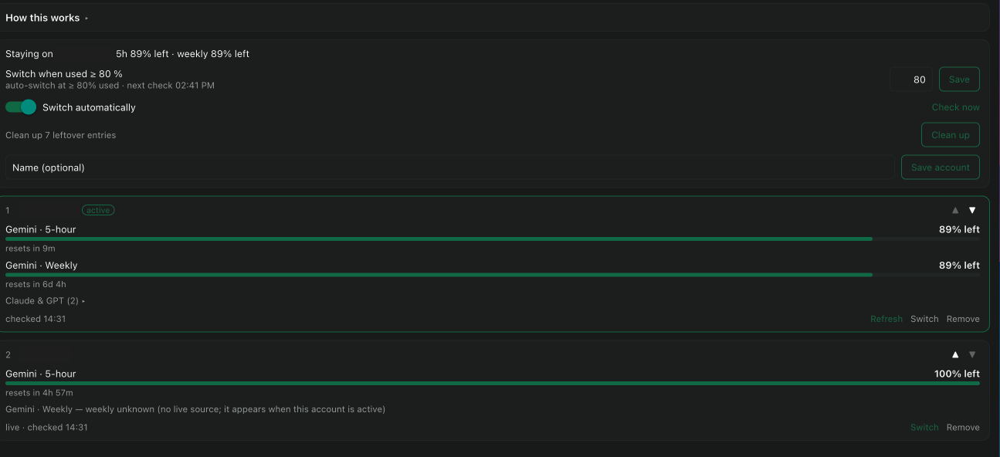

# agy rotator (Windows)

Keep several Antigravity (`agy`) sign-ins on one Windows machine and rotate to the next one, in your order, when the
active account runs low. `agy` holds exactly one sign-in per Windows user, so on Windows there is no per-folder trick to
run two accounts side by side; on Linux and macOS, antigravity-cli's built-in multi-account already covers this.

## What you get

- **Save each account once** - sign in with `agy`, press **Save account**, name it. Saved sign-ins stay in Windows
  Credential Manager; the plugin's own files hold labels and quota figures only.
- **Switch when used >= N %** - default 80, any value from 1 to 99. Either Gemini bucket (5-hour or weekly) can trigger it.
- **Your order** - accounts are tried in their numbered order after the active one, wrapping around; move them with
  up/down at any time. A manual Switch on any card works too.
- **Live 5-hour bars for every saved account**, refreshed every 5 minutes; the weekly figure of an inactive account is its
  last reading (no service exposes it live).
- **Idle `agy` agents in Paseo reload onto the new account and keep their chats**; busy ones follow when their turn ends.
- **How this works** help on the screen, a needs-sign-in badge for dead sign-ins, and a Clean up for leftover entries.

## Good to know

- Windows only, Paseo 0.13.0 or newer.
- It talks to Google: the token endpoint and the same quota endpoint `agy` uses, with agy's built-in app key read from
  your own `agy.exe` at run time (never stored or shipped) and an `antigravity` user-agent.
- An `agy` you started yourself in a terminal keeps the old account until you restart it.
- Whether rotating several Google accounts fits Google's terms is your call.

See [README.md](README.md) for the security model and details.
