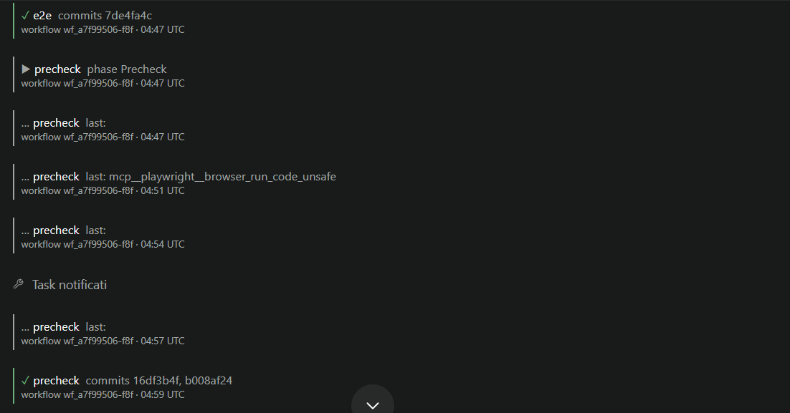

# Workflow Progress

A Claude Code Workflow runs its sub-agents inside one Claude session. Paseo sees that as one long tool call, so the chat shows a single line for what can be an hour of work. Workflow Progress adds a small card to the agent's timeline for each step of the workflow.

## What it shows

Each card names the step and the workflow, with a time:

- `▶ <step>  phase <name>` when a step starts.
- `… <step>  last: <tool> — <command>` every 3 minutes while a step runs, showing the most recent tool call or message of its sub-agent (trimmed to 90 characters), so a step that runs for an hour without a journal line still shows what it is doing.
- `✓ <step>  commits <hashes>` when a step finishes, with the commit hashes and status from its result.
- `⚠ <step>` once, when a started step's sub-agent has written nothing for 20 minutes, so a stalled workflow is visible without opening Claude Code's `/workflows` view.
- When the plugin first sees a running workflow, it posts one summary card instead of replaying the whole history.

## How it works

Every 15 seconds the plugin reads the workflow journals Claude Code writes under `~/.claude/projects/<project>/<sessionId>/subagents/workflows/<workflow>/journal.jsonl`, matches each session to the Paseo agent that owns it, and appends cards to that agent's timeline. Journals untouched for a day are ignored.

## Limits

- State is kept in memory. After a daemon or plugin restart, the next poll posts a fresh summary card for each live workflow.
- Only Claude Code agents run Workflows; other providers are unaffected.

## Data and permissions

It reads Paseo's agent records and Claude Code's workflow journals and sub-agent transcripts on the daemon host, and it appends cards to agent timelines. The `last:` cards copy the start of the sub-agent's latest command or message into the timeline, so anything in those commands (paths, file names) appears there too. It does not modify the journals and makes no network requests.
